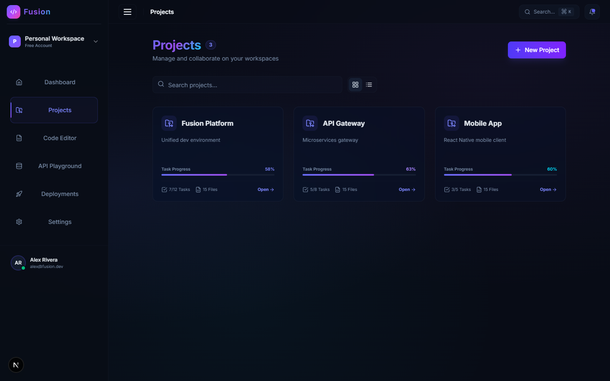
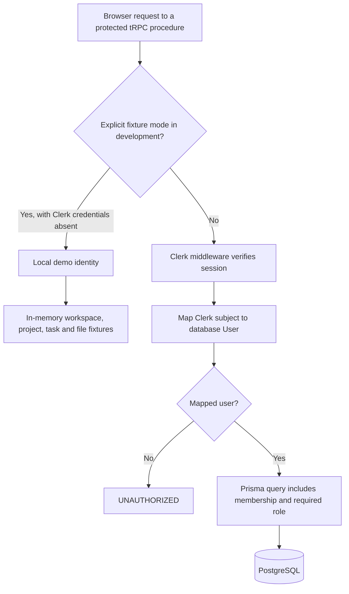

# Fusion

Fusion is a Next.js workspace for managing projects, tracking tasks, and editing code. Its tRPC API has four routers for workspaces, projects, tasks, and code files. You can explore those screens with local sample data or connect the API to Clerk and PostgreSQL.



This screenshot was captured from the running local demo at 1440 × 900. The project names and task counts are fixture data. The progress percentages and file counts on the cards are illustrative.

## Run the local demo

Use Node.js 20.19+ or 22.12+ and the repository's pnpm 8.15.0. From the repository root:

```sh
pnpm install --frozen-lockfile
pnpm --filter @repo/db generate
cp .env.example apps/web/.env.local
pnpm --filter web exec next dev --hostname 127.0.0.1
```

On Windows, use `Copy-Item .env.example apps/web/.env.local` for the copy step. Open [Projects](http://localhost:3000/projects). Select **New Project**, choose a workspace, enter a name, and create the project. It will appear in the list until the development server restarts.

The example enables `FUSION_USE_MOCK_DB=1` and leaves both Clerk credentials as placeholders. With that explicit setting, a development server uses one demo identity and in-memory fixtures for the four protected routers. Restarting the process discards demo edits. Installing dependencies and fetching fonts can require network access.

## Run with your own workspace

Set `FUSION_USE_MOCK_DB=0`, `NEXT_PUBLIC_CLERK_PUBLISHABLE_KEY`, `CLERK_SECRET_KEY`, and `DATABASE_URL` in `apps/web/.env.local`. Supply the same database URL to the Prisma CLI when applying the schema to your own development database. The database package exposes `generate`, `migrate`, and `studio` scripts.

Provision a database `User` whose `clerkId` matches the signed-in Clerk subject. A user can create a workspace and receives the owner role, or access an existing workspace through a `WorkspaceUser` membership. The application requires both Clerk keys, a verified session, and a mapped database user. Missing identity returns `UNAUTHORIZED` from protected procedures. Production always uses the authenticated path.



| Database operation | Required workspace role |
|---|---|
| Read a workspace, project, task, or file | Owner, admin, member, or viewer |
| Create, edit, or delete a project, task, or file | Owner, admin, or member |
| Change workspace metadata | Owner or admin |
| Delete a workspace | Owner |

The API disregards caller-supplied identity headers. Cross-workspace resources are omitted from lists, and inaccessible targets return `NOT_FOUND`. Task assignees must belong to the project's workspace. File creation requires matching project and workspace IDs. When a legacy document or file links two different workspaces, conflicting parent deletions are blocked to protect the other workspace's data. Workspace invitations return `NOT_IMPLEMENTED` for authorized callers.

## Screens and integrations

- **Projects and tasks** use the typed tRPC API for queries and mutations. Dashboard activity and some summary metrics use sample or estimated values.
- **Code editor** provides a Monaco interface and Yjs collaboration components. The editor page starts with sample files. Workspace permissions described above apply to the tRPC API. Peer-room access is a separate integration.
- **API playground and settings** include browser-side demonstrations. The settings screen's token and password controls are illustrative. The deployments screen displays a sample deployment timeline.
- **AI and queue packages** contain helper code for model requests and BullMQ jobs. Using these integrations requires their own credentials or services.

The repository includes earlier captures of the [task board](docs/screenshots/04-project-detail.png), [editor](docs/screenshots/05-editor.png), and [API playground](docs/screenshots/06-api-playground.png).

## Verify the access rules

```sh
pnpm --filter web test
pnpm --filter web type-check
```

The regression suite sends requests through the real tRPC fetch adapter and invokes all four routers against two workspace fixtures. It supplies test doubles for Clerk and Prisma. It covers forged headers, unmapped users, demo isolation, role permissions, task assignments, code-file ownership, and legacy deletion cascades. A live Clerk session and PostgreSQL integration need separate verification.

The Prisma schema is in [packages/db/prisma/schema.prisma](packages/db/prisma/schema.prisma). The API is in [apps/web/server](apps/web/server). [Contributing](docs/contributing.md) covers development commands. The project uses the [MIT license](LICENSE).
